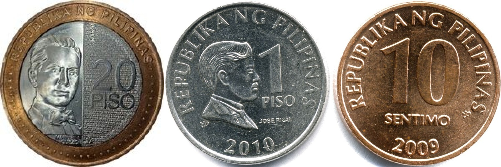
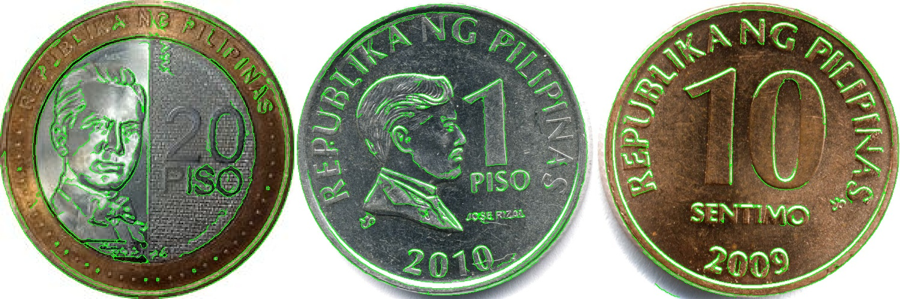
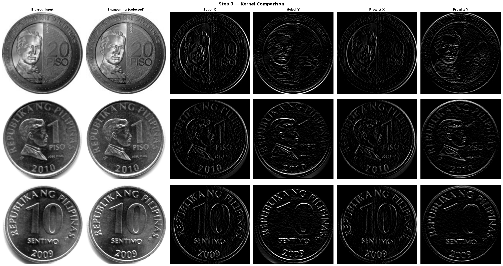
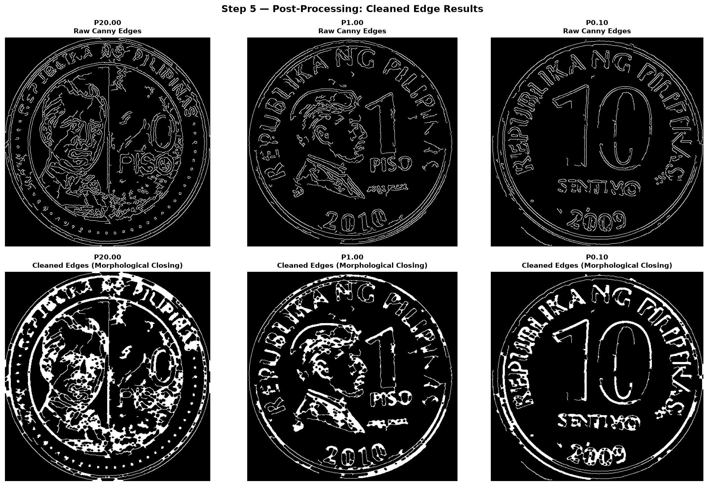
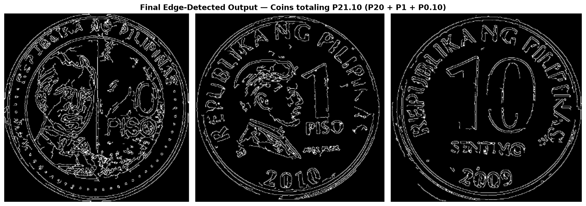
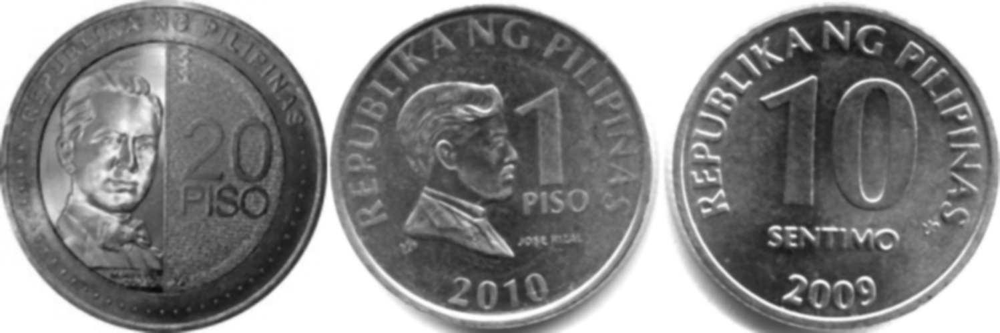
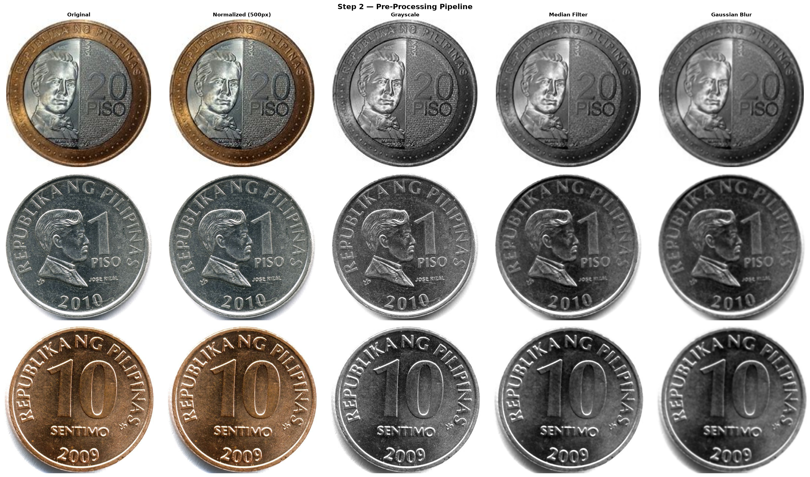
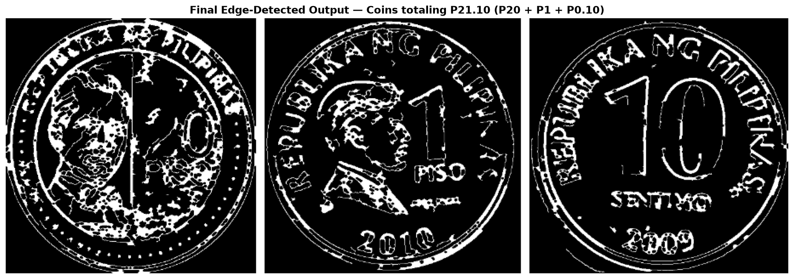

<div align="center">

# CSEC 5 · Computer Vision

**Philippine coin edge detection with convolution, Canny and morphology in OpenCV**


-success)

</div>

## Overview

This repository holds the work for **Laboratory Activity 1** of a Computer Vision course (CSEC 5): given photos of Philippine coins, pick the coins that add up to **₱21.10** (₱20 + ₱1 + 10 centavos) and process them so the rims and markings show up as clean edges.

The pipeline is: grayscale → median filter → Gaussian blur → sharpening convolution → Canny edge detection → morphological closing. It exists in three forms:

- a **script** that processes the three coins as one combined image,
- a **working notebook** that processes each coin separately and compares five convolution kernels,
- the notebook **as submitted** for the activity.

Skills demonstrated: image loading and resizing, spatial filtering (median, Gaussian), 2-D convolution with hand-written kernels, Canny edge detection, morphological post-processing, contour extraction, and Matplotlib figures for comparing stages.

This is a classical image-processing exercise. The programs produce edge images; they do not detect or classify coins automatically.

## Results at a glance

The images below are the files committed in [`results/`](results/) and [`submitted/`](submitted/). The script's JPGs were reproduced exactly by a fresh run (see [Sample results](#sample-results)).

**Script: original → edges → edges overlaid on the original** (the three selected coins, ₱20 + ₱1 + 10 centavos)






**Notebook: five convolution kernels compared** (left to right: blurred input, sharpening, Sobel X, Sobel Y, Prewitt X, Prewitt Y)



**Notebook: raw Canny edges (top) vs. after 5×5 closing (bottom).** The 5×5 closing joins the rims and numerals but also merges dense areas, such as the ₱20 portrait, into thick white regions. The submitted notebook used 3×3 instead:





## Table of contents

- [Results at a glance](#results-at-a-glance)
- [Getting started](#getting-started)
- [Repository structure](#repository-structure)
- [Programs](#programs)
- [Dataset](#dataset)
- [Methodology](#methodology)
- [Sample results](#sample-results)

## Getting started

**Requirements**

- Python 3.12 or newer (tested on 3.12.14 and 3.14.8, Linux)
- `opencv-python-headless`, `numpy`, `matplotlib`, `scipy` (scipy is used by the notebooks only), and `jupyter` for the notebooks
- No display is needed. The script never opens a window, and the notebooks draw with Matplotlib, which also works headless with `MPLBACKEND=Agg`
- All inputs are in the repository ([`coins-dataset/`](coins-dataset/))

**Setup and run**

```bash
python3 -m venv .venv && source .venv/bin/activate
pip install opencv-python-headless numpy matplotlib scipy jupyter

# 1. Script: writes output/output_01_*.jpg ... output_09_*.jpg
python coin-detection-pipeline.py

# 2. Notebooks: open and run all cells (writes PNG figures; see below)
jupyter lab coin-detection.ipynb
jupyter lab coin-detection-submitted.ipynb

# or run a notebook headlessly, keeping the executed copy outside the repo
MPLBACKEND=Agg jupyter nbconvert --to notebook --execute coin-detection.ipynb --output-dir "$(mktemp -d)"
```

Run everything **from the repository root**: all paths (`coins-dataset/`, `output/`) are relative to the working directory, and the notebooks open with their own folder as the working directory, so they must stay next to `coins-dataset/`.

Where files are written:

| Program | Writes to |
|---|---|
| `coin-detection-pipeline.py` | `output/` (created if missing) |
| `coin-detection.ipynb` | `output/` (created if missing) |
| `coin-detection-submitted.ipynb` | the current folder, as `output_0N_*.png` |

These locations are git-ignored. The images kept in the repository are in `results/` (see below), so a run never overwrites them.

## Repository structure

```text
coin-detection-opencv/
├── README.md
├── .gitignore
├── coin-detection-pipeline.py          # script version (combined image)
├── coin-detection.ipynb                # working notebook (per-coin, kernel comparison)
├── coin-detection-submitted.ipynb      # notebook as submitted
├── coins-dataset/                      # 9 coin photos (supplied for the activity)
├── docs/
│   └── week1-lab1-instructions.md      # the activity brief
├── results/
│   ├── script/                         # 9 JPGs produced by the script
│   └── notebook/                       # 8 PNGs produced by the working notebook
└── submitted/                          # the two result images as submitted
```

## Programs

Dates are **file last-modified dates** (YYYY-MM-DD) taken from the files on disk. This is not a git repository, so there is no commit history to use instead. "—" means the date in this repository is not the real one (see the footnotes).

### Scripts

| File | What it does | Concept practiced | Last modified |
|---|---|---|---|
| [`coin-detection-pipeline.py`](coin-detection-pipeline.py) | Loads the ₱20, ₱1 and 10-centavo photos, resizes them to 500 px height, joins them side by side, runs the full pipeline on the joined image, and saves nine numbered images | End-to-end spatial filtering and edge detection; contours; overlaying edges on the original | 2026-08-16 |

### Notebooks

| File | What it does | Concept practiced | Last modified |
|---|---|---|---|
| [`coin-detection.ipynb`](coin-detection.ipynb) | Loads all nine photos, selects the three for ₱21.10, runs the pipeline **per coin**, compares five convolution kernels (sharpening, Sobel X/Y, Prewitt X/Y), uses a 5×5 closing, and saves nine PNG figures | Convolution kernels and their effect; parameter choice; visual comparison of stages | — ¹ |
| [`coin-detection-submitted.ipynb`](coin-detection-submitted.ipynb) | The version handed in. Same code except a 3×3 closing and figures saved to the current folder instead of `output/` | Same as above | — ² |

¹ ² The notebooks in this repository had their stored outputs cleared on 2026-10-19, which re-saved the files, so the date on disk (2026-10-19) is not their real date. The uncleared originals on the author's disk, whose cell contents are identical to these, are dated 2026-08-16 (working notebook) and 2026-08-15 (submitted notebook). Those are the dates of the originals, not of the files in this repository.

### Other files

| Path | Contents | Last modified |
|---|---|---|
| [`coins-dataset/`](coins-dataset/) | Nine coin photos (see [Dataset](#dataset)) | 2026-02-22 ³ |
| [`docs/week1-lab1-instructions.md`](docs/week1-lab1-instructions.md) | The activity brief: objective, steps, expected output, submission requirements | 2026-08-15 |
| [`results/script/`](results/script/) | Output of the script | 2026-08-16 |
| [`results/notebook/`](results/notebook/) | Output of the working notebook | 2026-08-16 |
| [`submitted/`](submitted/) | The two images as submitted | 2026-08-15 |

³ This is the date on the supplied photo files, not a creation date of the photos themselves.

## Dataset

The coin photos were supplied for the activity ([instructions](docs/week1-lab1-instructions.md) say to use only this set). Image sizes are as stored.

| File | Coin | Size (px) | Used |
|---|---|---|---|
| `20_piso.jpg` | ₱20 | 196×200 | yes |
| `1_piso.jpeg` | ₱1 | 640×638 | yes |
| `10_sentimo.jpeg` | 10 centavos | 608×599 | yes |
| `10_piso_1.jpeg`, `10_piso_2.jpeg` | ₱10 | 260×265, 155×148 | no |
| `5_piso_1.jpeg`, `5_piso_2.jpeg` | ₱5 | 157×159, 735×630 | no |
| `5_sentimo_1.jpeg`, `5_sentimo_2.jpeg` | 5 centavos | 736×736, 250×242 | no |

The three selected coins differ a lot in resolution: the ₱20 photo is about 200 px across, the other two about 600 px.

## Methodology

All parameters below are read from the code.

### Pipeline

| Stage | Script (`coin-detection-pipeline.py`) | Working notebook (`coin-detection.ipynb`) |
|---|---|---|
| Input | the 3 selected photos | all 9 photos loaded; 3 selected |
| Resize | each to **height 500**, width `int(w·500/h)`, `INTER_AREA`; then joined with `np.hstack` (no gap) into one 500×1498 image | each coin to **largest side 500** (`int(w·s)`, `int(h·s)`, `s = 500/max(h,w)`), `INTER_CUBIC`; processed separately (500×490, 498×500, 492×499) |
| Grayscale | `cv2.cvtColor(BGR2GRAY)` | same |
| Median filter | `cv2.medianBlur`, 5×5 | `scipy.ndimage.median_filter`, size 5 |
| Gaussian blur | `cv2.GaussianBlur`, 7×7, σ = 1.5 | same |
| Convolution | `cv2.filter2D` with the sharpening kernel | `cv2.filter2D` with five kernels; only the sharpening output feeds Canny |
| Edges | `cv2.Canny(·, 45, 120)` | same |
| Cleaning | closing with a **3×3** ellipse | closing with a **5×5** ellipse, 1 iteration (the submitted notebook uses 3×3) |
| Final output | contours (`RETR_EXTERNAL`, drawn green, thickness 2); overlay of edges on the original | each cleaned edge map resized to height 300 and joined with a 10 px white separator |

### Kernels

Sharpening (used in the pipeline), with row-by-row layout:

```text
 0 -1  0
-1  5 -1        out(x,y) = 5·I(x,y) − I(x−1,y) − I(x+1,y) − I(x,y−1) − I(x,y+1)
 0 -1  0
```

The weights sum to 1, so flat regions keep their brightness. The result is stored as 8-bit, so values are clipped to [0, 255]. The notebook also applies Sobel X `[[-1,0,1],[-2,0,2],[-1,0,1]]`, Sobel Y `[[-1,-2,-1],[0,0,0],[1,2,1]]`, Prewitt X `[[-1,0,1],[-1,0,1],[-1,0,1]]` and Prewitt Y `[[1,1,1],[0,0,0],[-1,-1,-1]]` for comparison only.

### Canny and closing

`cv2.Canny` is called with low threshold 45 and high threshold 120 (ratio 2.67) and OpenCV's default aperture size. Pixels above 120 are strong edges; pixels between 45 and 120 are kept only if connected to a strong edge.

Closing is dilation followed by erosion with the same structuring element B: `E • B = (E ⊕ B) ⊖ B`. The elements are `cv2.MORPH_ELLIPSE`:

```text
3×3:  0 1 0      5×5:  0 0 1 0 0
      1 1 1            1 1 1 1 1
      0 1 0            1 1 1 1 1
                       1 1 1 1 1
                       0 0 1 0 0
```

### How the results were produced, and what they show

The results here come from running the programs unchanged on the supplied photos (details under [Sample results](#sample-results)). The saved images in `results/` were reproduced from the code: the script's JPGs were identical to a fresh run on both software stacks tested, and the notebook's PNGs were identical to a fresh run on the newer stack.

What this supports: with these parameters the pipeline gives visible, mostly closed rims and readable numerals on these three photos, and the edge-pixel counts printed by the notebook show how much closing adds (e.g. ₱20: 23 642 → 49 587 pixels with 5×5, → 25 867 with 3×3).

What it does not show: there is no quantitative evaluation, no ground truth, and no test on other images. The thresholds and kernel sizes are fixed values chosen for these photos (the notebook says they were tuned for the ₱20 markings), so nothing here shows they work elsewhere. The total ₱21.10 is chosen by hand; nothing in the code recognises denominations or sums them.

## Sample results

Real output from this repository's code, run headlessly in a scratch directory outside the repo (Matplotlib `Agg` backend, so `plt.show()` shows nothing; notebooks executed with `jupyter nbconvert --execute`, with the first `%pip install` cell replaced by a log line in the scratch copy). Two software stacks were used:

| | Python | OpenCV | NumPy | SciPy | Matplotlib |
|---|---|---|---|---|---|
| A | 3.14.8 | 5.0.0 | 2.5.4 | 1.18.1 | 3.11.2 |
| B | 3.12.14 | 4.9.0 | 1.26.4 | 1.13.1 | 3.8.4 (IPython 8.39.0) |

The script's log and the notebooks' printed numbers were the same on both stacks apart from the version lines. The logs below are from stack A.

<details>
<summary><b>coin-detection-pipeline.py</b> (run log)</summary>

```text
Loaded 20_piso: (200, 196, 3)
Loaded 1_piso: (638, 640, 3)
Loaded 10_sentimo: (599, 608, 3)
Saved combined original: (500, 1498, 3)
Saved grayscale
Saved median filter
Saved Gaussian blur
Saved sharpened
Saved Canny edges
Saved morphological closing
Saved final with contours
Saved final overlay

Pipeline complete. Outputs saved to output/
```

The nine images written are the ones in [`results/script/`](results/script/). Each stage, in order (1498×500 each):

| Stage | Image |
|---|---|
| Grayscale |  |
| Median 5×5, then Gaussian 7×7 (σ 1.5) |  |
| Sharpening convolution |  |
| Canny (45, 120) |  |
| Closing, 3×3 ellipse, with external contours in green |  |
| Edges over the original (edges recomputed without the sharpening step) |  |

</details>

<details>
<summary><b>coin-detection.ipynb</b> (printed output of all cells)</summary>

```text
[headless run] skipped %pip install cell

Libraries loaded successfully!
OpenCV version: 5.0.0
NumPy version: 2.5.4
Output directory ready: output/

  Loaded: 20_piso.jpg            -> P20.00  (200, 196, 3)
  Loaded: 10_piso_1.jpeg         -> P10.00 (1)  (265, 260, 3)
  Loaded: 10_piso_2.jpeg         -> P10.00 (2)  (148, 155, 3)
  Loaded: 5_piso_1.jpeg          -> P5.00 (1)  (159, 157, 3)
  Loaded: 5_piso_2.jpeg          -> P5.00 (2)  (630, 735, 3)
  Loaded: 1_piso.jpeg            -> P1.00  (638, 640, 3)
  Loaded: 10_sentimo.jpeg        -> P0.10  (599, 608, 3)
  Loaded: 5_sentimo_1.jpeg       -> P0.05 (1)  (736, 736, 3)
  Loaded: 5_sentimo_2.jpeg       -> P0.05 (2)  (242, 250, 3)

Total images loaded: 9

Dataset overview saved as output/output_01_all_dataset_coins.png

Selected coins for P21.10:
  P20.00   <- 20_piso.jpg
  P1.00    <- 1_piso.jpeg
  P0.10    <- 10_sentimo.jpeg

Selected coins saved as output/output_02_selected_coins.png

Combined image saved as output/output_03_combined_selected_coins.png

Pre-processing complete for all coins.
  Normalize size     : 500 px (max dimension)
  Median filter size : 5x5
  Gaussian kernel    : (7, 7)
  Gaussian sigma     : 1.5

  P20.00: normalized shape = (500, 490)
  P1.00: normalized shape = (498, 500)
  P0.10: normalized shape = (492, 499)

Pre-processing visualization saved as output/output_04_preprocessing.png

Kernels defined:
  Sharpening (selected): sum=1.0
  Sobel X: sum=0.0
  Sobel Y: sum=0.0
  Prewitt X: sum=0.0
  Prewitt Y: sum=0.0

Input patch (5x5 pixel values from P20.00 blurred image):
[[110 106 104 102 102]
 [108 104 101 101 101]
 [106 102 100  99 100]
 [104 101  99  99 100]
 [102 100  99  99 100]]

Sharpening (selected)     : raw=   103.0  clipped=103.0
Sobel X                   : raw=   -26.0  clipped=0.0
Sobel Y                   : raw=   -16.0  clipped=0.0
Prewitt X                 : raw=   -19.0  clipped=0.0
Prewitt Y                 : raw=    12.0  clipped=12.0

Convolution applied with all kernels:
  Sharpening (selected): output range [4, 255]
  Sobel X: output range [0, 255]
  Sobel Y: output range [0, 255]
  Prewitt X: output range [0, 255]
  Prewitt Y: output range [0, 190]

Sharpening kernel output will be used in Step 4 (Canny).

Kernel comparison saved as output/output_05_convolution.png

Canny parameters:
  Low threshold  : 45
  High threshold : 120
  Ratio (high/low): 2.67

  P20.00: 23642 edge pixels (9.65% of image)
  P1.00: 16687 edge pixels (6.70% of image)
  P0.10: 14982 edge pixels (6.10% of image)

Canny edge detection applied to all coins.

Edge detection results saved.

Morphological structuring element (elliptical):
[[0 0 1 0 0]
 [1 1 1 1 1]
 [1 1 1 1 1]
 [1 1 1 1 1]
 [0 0 1 0 0]]

Kernel size: 5x5
Shape: ELLIPSE (best for circular coin outlines)

  P20.00: edge pixels 23642 -> 49587 (delta: +25945)
  P1.00: edge pixels 16687 -> 31276 (delta: +14589)
  P0.10: edge pixels 14982 -> 28506 (delta: +13524)

Morphological post-processing complete.

Cleaned edges saved.

Final edge output saved.

Full pipeline summary saved.
```

Nine figures are written to `output/`. The ones committed in [`results/notebook/`](results/notebook/) matched a fresh run on stack A pixel for pixel; on stack B the figures differed only by one pixel in canvas size because of Matplotlib's layout. Figures produced by the run, as committed:

Pre-processing per coin (original, normalized, grayscale, median, Gaussian):



Kernel comparison:


Raw Canny edges (top) and after 5×5 closing (bottom):


Final combined edge output (5×5 closing):



</details>

<details>
<summary><b>coin-detection-submitted.ipynb</b> (differences from the working notebook)</summary>

The printed output is the same as the working notebook's except for the lines below: the figures are saved to the current folder (no `Output directory ready` line, no `output/` prefix in the "saved" lines), and the closing uses a 3×3 element.

```text
Morphological structuring element (elliptical):
[[0 1 0]
 [1 1 1]
 [0 1 0]]

Kernel size: 3x3
Shape: ELLIPSE (best for circular coin outlines)

  P20.00: edge pixels 23642 -> 25867 (delta: +2225)
  P1.00: edge pixels 16687 -> 18034 (delta: +1347)
  P0.10: edge pixels 14982 -> 15838 (delta: +856)
```

The submitted images are [`submitted/lab1-submitted-original-combined.png`](submitted/lab1-submitted-original-combined.png) and [`submitted/lab1-submitted-edge-output.png`](submitted/lab1-submitted-edge-output.png):


</details>
